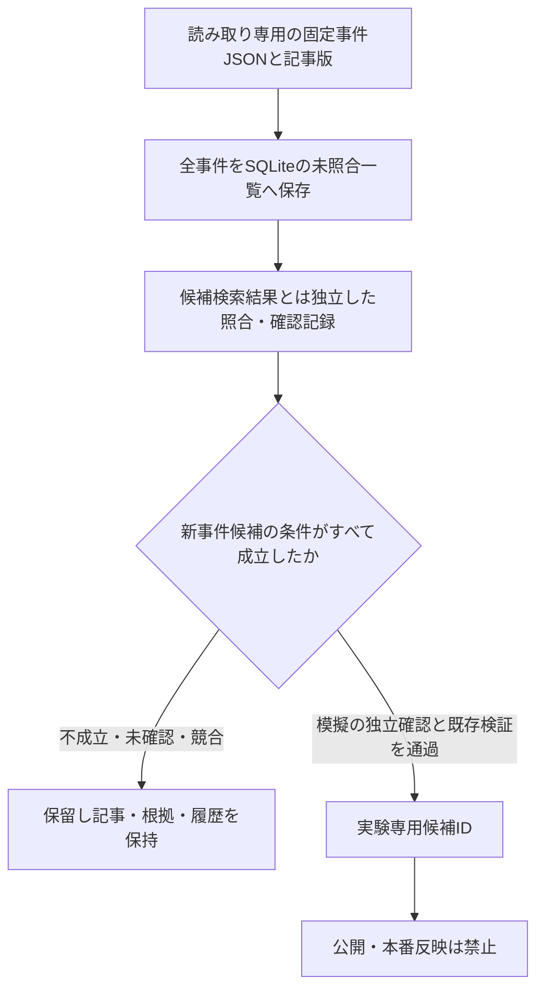

# 新事件作成前の隔離安全装置

本番の事件作成処理には接続しない。案Aの4/2/4、予算・追跡保護・不成立再試行抑止を変更しない。
追加API通信、ニュース取得、検索、Actions実行は行わない。

```sh
python -m unittest experiments.allocation_lab.test_new_event_guard -v
```

## データと確認の流れ



入力の事件ファイル全体を期待するSHA-256で固定する。公開停止・休眠・統合済みなどの事件も読み込み、検索結果にない事件を除外しない。
チェックサムは「固定ファイル内の全件を読んだ」ことを示すだけで、世の中の全事件や保存漏れまで網羅した証明ではない。
記事・事件・検証方式が変わったら別の確認対象となり、古い確認を自動移行しない。

SQLiteには次を分けて保存する。

- `contexts`: 記事・記事版・事件構成・検証版の固定状態。
- `candidates`: 全事件IDと各事件のハッシュ、未照合／要確認／人手別事件確認記録あり／同一確認記録あり／競合。
- `reviews`: 追記式の確認理由・引用・出典種類・確認日時・確認者・記事版・事件ハッシュ。
- `operations`: 操作ID、要求ハッシュ、結果。異なる要求での操作ID再利用を拒否。
- `proposals` / `proposal_links`: 実験専用候補と、その対象版・根拠・確認記録。実際の事件や公開データとは別物。

未照合一覧・結果・候補ID・操作結果はSQLiteトランザクションで保存する。
処理中の障害ではまとめて巻き戻し、同じ操作を再実行しても候補を二重発行しない。
記事改訂では旧版の対象・確認記録を保持し、新版は未照合から再確認する。
同じ番号だけを理由に別の確認対象を既存候補へ結び付けない。未解決の別の実験候補がある場合も保留する。

## 実験用候補の許可条件

次の条件をすべて満たした場合だけ `lab-only-...` の候補を保存する。通常の事件IDは一切発行しない。

1. 記事版・対象事件構成・元ファイルのハッシュ・現在の検証版が一致する。
2. 固定事件一覧のすべてに、独立した人手の別事件確認記録がある。AIの否定回答や検索漏れでは代用しない。
3. この狭い試作では、同一の明示された管轄・識別方式に属する案件番号、両側の記事版に一致する引用、人手による出典確認の記録を必要とする。欠けた情報を推測で作らない。
4. 案件番号が違うだけでは許可せず、別の発生事実だと独立して確認したという記録も必要とする。同じ番号なら新事件候補を止める。
5. 上記とは別に、新事件候補を認める明示的な人手確認記録が、現在の対象版に対して存在する。
6. 元の追跡処理が使う `evidence`、`apply_report`、`validate_saved_update` を、コピーしたデータに対して通過する。
7. 競合する確認、同一事件確認、未照合、未解決の別候補がない。

`MockOperatorConfirmation` は架空テスト専用の別経路の確認オブジェクト。
AIのJSON内に `authority=operator` などを書くだけでは確認として受け付けない。
これは本番認証・電子署名ではなく、実際の運営者の本人確認は実装していない。
既存の運営者判断JSONや過去の正解ラベルを、自動でこの確認に変換する処理もない。

保存内容との文字列一致は、本文取得・出典の信頼性・事件同一性の証明ではない。
案件番号の存在や意味もプログラムが独立に調査したものではない。
大半の実ニュースはこの条件を満たせないため、本試作では保留する。
同一事件との回答も、自動統合・記事の自動紐付けには使わず別の安全確認へ保留する。

## 反例テストと残る反例

少なくとも次の条件を通信なしで確認する。

- AIが同一事件を新事件と誤判定 → 未照合のため保留。
- AIが別事件を同一事件と誤判定 → 自動統合経路がなく保留。
- 候補検索が既存事件を返さない → 全事件一覧に残り保留。
- 通信枠不足を模擬して照合を途中で止める → 再開後も未照合を保持。
- 保存後の中断・再開・同じ操作の再実行 → 候補IDと結果を維持。
- 記事の改訂 → 古い確認の再利用を拒否、旧版と履歴を保持。
- 保存障害・操作ID競合・引用版不一致・古い事件構成・検証版変更 → 停止または保留。
- 別の確認対象を、番号一致だけで過去の候補へ結び付けない。

**残余反例:** 同じ発生事実に複数の案件番号があり、独立した人手の別事件確認と新事件確認が両方とも誤っていると、実験用候補が通る。
この反例を再現する特性テストの成功は、安全性の合格ではない。
単なる番号の差・引用一致から、プログラムが現実の別事件性を証明できたとは報告しない。
実験用候補にも誤りが残り得るため、本番の自動作成を有効にする根拠にはならない。

## 保留・待機への影響

この安全装置は、現在地生成の前処理ではなく、事件作成前の停止条件の試作。
現在地生成が通過しても、事件との対応が確認できなければ下流で待機する。
保留は削除せず、条件変更や人手の追加確認で新しい操作として再評価する。
同じ不成立条件を繰り返しAPIへ送る機能はない。

保留を減らした実績や進展検知精度は測定していない。
確認対象の組数を通信回数へ換算しない。追加照合を今後AIに任せる場合の通信数・費用は未確認。
案Aの予算内で進める方法は別途検証が必要。

## 本番接続の阻止条件

- 正解付きの独立標本で、複数案件番号・長期続報・共有記事・事件分割統合を含めて評価できていない。
- 本番の運営者認証、信頼できる確認記録、競合解消・訂正の実務が未実装。
- 旧運営者判断・別事件制約・引用の出典検証との本番接続がない。
- 固定JSONの読取りと本番事件作成をまたぐ並行更新・クラッシュ整合性を保証していない。
- 実験の操作ID重複防止は、実API呼び出しの二重課金防止を保証しない。
- 案件番号のない記事を含め、人手の負担を増やさず保留を解消する方法が未確認。

現段階では本番接続不可。現行エンジンやPR #17へ変更を広げず、実験用候補をそのまま本番へ移さない。
