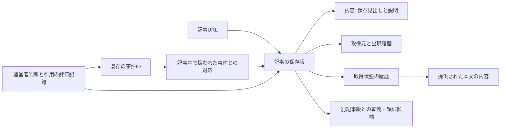

# 記事重複と事件同一性を分離する設計

同じ記事であることと、同じ事件であることを別々に判断します。1記事が2つの事故を報じている場合、記事の保存版は共有しても、2つの事件IDと対応関係を残します。

今回追加したものは、SQLite内の独立した記事管理表と読み込み・評価用処理です。既存の判定処理・安全検証は再利用し、新管理表を本番の正本にはしていません。採用・訂正・取消し後の自動同期まで完成した新エンジンではありません。



`E → M → V` は多対多です。1事件に複数記事、1記事に複数事件を対応させます。転載候補から事件を統合する経路はありません。

## データの分け方

|対象|追加テーブル|役割・安全上の意味|
|---|---|---|
|URL|sep_urls|元URLを変更せず保持。別URLを勝手に代表URLへ置換しない|
|内容|sep_contents|保存見出し・説明と、明示的に提供された本文を別の表現として区別。見出しだけの一致を全文一致と呼ばない|
|記事版|sep_versions|URL・見出し・説明・公開日時から保存版を識別。公開日時だけ変わっても別版。本文取得による内容は別に履歴化|
|収集・出現履歴|sep_occurrences|出現元ファイルとJSON内の位置、元の全フィールドを保存。収集メタデータの差だけで記事改訂を増やさない|
|旧版との対応|sep_legacy_versions|従来の改訂IDと新しい記事版の対応を保持|
|記事と事件|sep_event_mentions|既存の事件ID・記事版・current/historyを保持。元の対応は未再検証のまま。事件ごとの引用範囲は未提供なのでnull|
|記事同士の関係|sep_article_relations|保存版一致、同じ見出し・日時、近似見出しを区別。別URLの転載は未確認候補のまま|
|運営者判断|sep_review_records|元の15組を変更せず追記保存。既存の本番振り分け設定へ流し込まない|
|取得状態|sep_fetch_observations|未実施・取得失敗・削除・空の抽出本文・本文あり、削除申告・空表示申告を別に記録|
|引用文書と履歴|sep_quote_documents / sep_quote_sources|7組の評価引用、元URL、記事版、確認日時を保存。更新は別文書として追記し、以前の提出を消さない|

元の `source_files`、`events`、`articles`、`revisions`、`event_articles`、`facts`、`operator_decisions`、`decisions`、`budget` などは書き換えません。SQLiteの書込み制限を付けた状態でも、新管理表の読み込み・重複候補記録が成功することをテストしています。

記事版IDは観測済みの4項目の一致を表すだけです。同一本文・同一著作物・同一事件のIDではありません。保存説明にRSSのリンクが含まれる場合は、その文字列差も保持します。

## 本文確認済み7組の評価形式

`source_quote_template.json` を使います。対象は024・025・027・028・029・031・032です。元の評価JSONと判断記録のハッシュ、事件ID、記事の証拠ハッシュを固定し、7組×2出典を用意しました。

```json
{
  "sample_id": "real-024",
  "event_id": "元の事件IDを維持",
  "evidence_sha256": "元の記事ペアのハッシュ",
  "operator_decision_recorded_at": "元の判断記録の日時",
  "sources": [
    {
      "role": "reference",
      "url": "元記事のURL",
      "version_id": "固定された保存版ID",
      "checked_at": null,
      "source_body_sha256": null,
      "quotes": []
    }
  ]
}
```

これは形式を説明する抜粋です。実ファイルにはreference（元記事）とincoming（新記事）の両方が必要です。

- `operator_decision_recorded_at` は添付された判断記録の日時です。本文を実際に確認した日時として流用しません。
- `checked_at` は実際の確認日時をタイムゾーン付きで記入できる欄です。日時が分からなければnullのままにします。公開日時や実行日時から推測しません。
- `quotes` は判断に使った短い原文を、そのまま保存する配列です。1引用500文字まで、1出典10引用まで。引用が提供されていなければ空配列です。
- `source_body_sha256` は確認に使った本文テキストのSHA-256を保存できる欄です。本文が保存されていなければnull。現在は全出典でnullです。
- メモから引用を作り直したり、複数の文章を連結して原文として扱ったりしません。
- 引用と確認日時を記入しても、検証状態は「運営者提供・原文との一致未検証」です。確定正解への昇格、事件統合、現在地更新には使いません。

別の事件ID・URL・版ID・データセット、重複する組や出典、長すぎる引用、時差情報のない日時、利用者による「検証済み」フィールドの追加は拒否します。

引用の入力画面、本文保存版との完全一致検証、既存の根拠検証へ本文引用を渡す接続は未実装です。JSONとして下書き保存・読み込みできますが、現在のAI入力に引用を自動追加しません。

## 取得状態の区別

|状態|意味|今回の実データ|
|---|---|---|
|not_attempted|この試作では本文取得していない|保存記事版に付与。過去にも一度も取得していないと断定する意味ではない|
|request_failed|タイムアウト等の明示的な失敗記録|実測なし。模擬記録で検証|
|deleted|404/410の明示的な観測記録|実測なし。模擬記録で検証。法的・恒久的な削除まで断定しない|
|empty_body|成功応答だが抽出本文が空文字|実測なし。模擬記録で検証。HTTP応答の全バイトが空とは限らない|
|available|提供された空でない本文|実データの提供なし。模擬記録で検証|
|reported_deleted|運営者が削除と報告|019・020・023・026の計5記事|
|reported_blank_display|運営者が本文表示なしと報告|021の新記事|

削除・空表示の申告には元の判断記録のハッシュとその記録日時を結び付けます。実際の取得日時・HTTP状態はnullのままです。JavaScript表示の失敗や有料記事等の理由は未確認であり、「空のHTTP応答」「削除済み」へ置換しません。

本文や状態が後から変わっても以前の観測は消さず、次の記録を追記します。実際の取得処理・再取得・API通信は実装していません。

## 重複処理と再評価の境界

今後の処理キーも二段に分けます。記事の処理済み印だけで、事件との照合を終了させません。

- 記事抽出の再利用キーは、保存版・提供本文の内容ID・抽出処理の版。出現履歴や確認日時だけが増えた場合は、同じ内容の抽出を繰り返さない設計とします。
- 事件との照合キーには、記事版と利用した根拠の内容ID、照合先事件ID、その事件の根拠版、既存の正式な運営者振り分け、検証処理の版、回答ハッシュを含めます。PR #16と同じく、同じ入力・不成立回答・検証条件の再消費を防ぎます。
- 022のように記事が処理済みでも、別の事件との対応は別の照合状態として残します。転載候補・記事の既読状態から、未照合を別事件や照合済みへ変更しません。
- 本文や根拠が実際に改訂された場合は再評価の対象にできますが、日0.20ドル/月5ドルと既存の回数上限の内側で保留・再開させる設計です。評価用のメモ・引用下書きは正式な根拠や振り分けとして自動採用しません。

これらのキーで既存の判定キャッシュと再開処理を置き換える接続は未実装です。今回の管理表を追加しただけで、本文変更のキャッシュ無効化やAPI入力削減が完成したとは扱いません。

## 実例と未完成部分

- **022**：同じ保存版を厚岸の事故と札幌北区の事故が共有。両事件IDを保持します。どの引用がどちらの事故を支えるかは未確定で、記事一致から統合しません。
- **030**：見出し・日時一致でも別URLを維持します。配信違いか重複収集かは未確認です。
- **033**：媒体・日時・末尾表記が異なるため、近似した記事の候補として保持します。同一記事・転載確定にはしません。

今回の管理表は既存JSONの固定スナップショットを映した読み込みモデルです。AIによる新規採用・訂正・取消しの後に表を同期する機能、公開JSONの出力、転載関係の確認・取消し、保存版を「最新」と判定する順序制御は未実装です。

次段階では、既存の安全検証を通った変更だけを事件側と記事側へ同じトランザクションで反映し、旧版・対応・根拠を残して取り消せるようにする必要があります。それまでは本番の正本として使いません。
