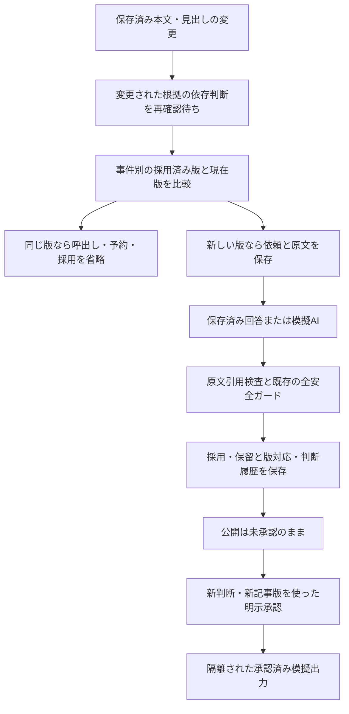

# 本文版による再判定・再承認経路

PR #17の隔離試作だけを変更。本番main・JSON・Actions・予算・公開先は変更しない。AIは保存済み回答または模擬回答のみ。

## already_savedの原因

`pending_triage.fingerprint/source_saved` はURL・見出し・RSS説明・公開日時を比較する。本文は別の `sep_contents/sync_source_states` にあるため、同じメタデータの本文100→120という改訂を既存の比較では区別できなかった。`engine.judge` の事前判定で already_saved となり、その後の安全検証と新判断作成に進めなかった。

本番側の関数は変更しない。試作に記事内容版と、事件別の採用済み版の対応を追加する。

## 新しい記事内容版

内容版IDは、既存のメタデータ版ID・本文内容ハッシュ・実際の変更世代から計算する。本文・見出し・説明・公開日時・根拠の有効状態が変われば新しい版として再確認する。同じ内容を観測し直しただけでは版を増やさない。過去の本文へ戻った場合も、変更が実際に起きた履歴を消して旧判断を復活させない。

|表|役割|
|---|---|
|sync_content_editions|実在する保存本文とメタデータ版・変更世代の不変な対応。観測し直しても同じ内容版の代表観測を使用|
|sync_content_heads|事件ID・URLごとの採用済み内容版。共有URLでも事件別に保持|
|sync_content_changes|採用操作ごとの対応表の変更前後。取消し時に復元|
|sync_revision_validations|新判断ID、旧版・新版、本文ハッシュ、ガード入力ハッシュ、採用後内容ハッシュと結果|
|sync_revision_requests|操作IDと元依頼・根拠・ジョブ・結果。保留・失敗時も入力を保存|
|sync_revision_transitions|準備・予算停止・採用・保留等の遷移。再開で待機表示が残らないよう更新|

元記事・旧版・根拠・判断・取消し・公開承認は削除しない。取得失敗は削除と区別し、最後の正常な版を保つが、その失敗を新しい本文の取得成功とみなさない。未取得・空本文・削除状態の本文判定は止める。

## 検証用ビューと既存ガード

既存ガードは本文フィールドを直接読めないため、一時検証DBの中だけで、保存済みメタデータに実在する保存本文と版識別子を併記した検証用ビューを作る。インターフェース上はdescriptionに渡すが、RSS抜粋と別の原文であることをプロンプトに明示する。**本来の記事descriptionは書き換えず、検証用ビューは保存用・公開用JSONに流さない。** 元データとの対応を使って必ず戻す。

これは検証を省略するforceフラグではない。既存の `preflight` → `evidence` → `apply_report` 内の同一性・矛盾・進展検証 → `validate_saved_update` を実行し、正規の記事へ戻した後も `validate_saved_update` をもう一度通す。

さらに回答中の新旧引用を、対応する元メタデータまたは保存本文に直接照合する。検証用ラベルや版IDを引用根拠にする回答は拒否する。検証用に付けた文字列を、新しい事実とみなさない。

URLを共有する別事件の版が後から採用されていても、対象事件自身が使った旧版を重複比較に使う。ガードの所有先制約は残し、他事件が所有するURLを根拠なく取り込まない。新規URLや取消しで一度外れた記事も、同じ安全検証を通過した場合だけ採用する。

運営者指定・除外・確認待ちは元の記録を保持する。一時ビューへ渡す際だけ、適用対象の指紋・ハッシュを対応するビューへ変換し、元記録を更新しない。事件同一性の根拠にはしない。

## 再判定と明示再承認



`content_revision.rejudge` が準備・模擬応答・検証・保存・再開を接続する。記事版が変わったら新しい操作ID、同じ処理の再開には同じ操作IDを使用する。古い操作IDを違う入力に使うと拒否し、古い判断が失効済みなら保存結果を新しい現在判断として返さない。

新判断は実際の引用も根拠IDへ結び付ける。公開する進展の引用を後で承認するとき、別の短い引用で代用する必要がない。本文だけの新判断が採用されても、公開承認は別の `publication.approve` 呼出しが必要。旧承認・旧判断を自動復活させない。

本文変更は自動的な進展ではない。進展・完結は既存の意味ある変化、引用、日時等の条件を維持する。古い記事公開日時を現在時刻に書き換えて進展を作らない。

## 再実行・障害・予算

同じ本文版、同じ入力・回答・条件の不成立は回答と検証メモを再利用し、AIの呼出し・失敗記録・予算予約を増やさない。実際に版を変更して復元した場合は新しい検証条件なので、版を含む新しい入力を使う。その版の再実行は再呼出ししない。

応答・予約は採用前に保存。採用・記事版対応・根拠・判断・操作結果は同じSQLite保存範囲で更新する。保存前の失敗は変更を戻し、保存後の応答消失は同じIDで再開する。応答が返ったか分からない障害は自動再呼出しせず確認待ち。取消しでは事件と記事内容版の対応を一緒に戻す。後の変更を巻き込む取消しは拒否する。

日0.20ドル・月5ドル、既存の回数上限を変えない。長文で予約額が上限を超える場合は、本文・依頼・未処理状態を保持して止める。入力サイズや模擬予約を実支出と混同しない。

## 残る阻止条件

実承認者認証・スマホUI、公開状態の実表示・配信、実本文の取得・抽出品質、実AI精度・実料金、長文の安全な入力制限・分割、全運用データ移行・永続DB復旧が残る。旧試作DBで採用済み本文版の対応が欠ける場合は、勝手に本文版を推測しない。未確認の引用・日時や正解ラベルを追加しない。

## 通信なしの再実行

固定入力は `f4b831d3fa1f514b2713ecca5acebc8a6aaaf99c` の読み取り専用コピー。比較用のpublic_events.jsonも同じ固定コミットのものを使用する。

```sh
python experiments/engine_v2/run_offline.py
python experiments/engine_v2/e2e_replay.py \
  --snapshot /path/to/frozen-copy \
  --reference-public /path/to/frozen-public_events.json \
  --output-dir /tmp/news-now-body-compat
python experiments/engine_v2/body_revision_replay.py \
  --snapshot /path/to/frozen-copy \
  --compatibility-report /tmp/news-now-body-compat/e2e_results.json \
  --output-dir /tmp/news-now-body-results
```

公開・承認は全て模擬。比較用JSONは公開に使用しない。mainへマージしない。
