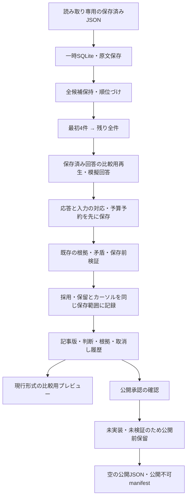

# 一気通貫試作の境界

本番移行不可。PR #17の隔離試作だけで、現行処理・本番JSON・Actions・予算は変更しない。



## 接続した処理

`end_to_end.py` は既存 `staged` のカーソル管理を使い、採用箇所を `revision_sync.adopt` に接続する。`staged.step` の追加引数は省略時に従来どおり動く。候補群を提示した時点の**実際のプロンプトと候補ID**で応答を保存し、その同じプロンプトを同期ジョブへ渡す。対象一件用プロンプトに回答を流用したり、正解ラベルから対象候補を先に決めたりしない。

判断同期ジョブは対象事件だけでなく提示候補全件の状態・記事メタデータも監視する。応答待ち中に候補状態や入力記事版が変われば、古い回答の採用とカーソル更新を止める。記事版の選択が衝突する場合は日時の新旧を推測せず、元キューを残して明示選択待ちにする。

根拠不足・不成立は「候補が別事件」とせず、各候補に未解決の判断記録を残す。運営者指定先と既存の振り分けルールは `staged.begin` と既存ガードをそのまま使う。評価用の運営者記録15件は原文のまま保存し、正解化しない。

`(4,'rest')` は候補65件以上でも残りを切らず提示する。大きな入力を実モデルへ送れる保証はない。実モデルの入力上限を超える場合の安全な追加分割は今後の課題で、勝手な切り捨てや新事件登録で解決しない。

## 応答・予算・障害

- `e2e_answers` はプロンプト原文、候補ID、比較用回答であることを記録する。
- `sync_answer_cache` と `sync_reservations` は応答採用より前に保存する。失敗後も同じ回答と予算予約を再利用する。
- 応答を受け取ったか不明な障害では再呼び出しせず、確認待ちとする。実際のAPI課金を保証する実装ではない。
- `e2e_decisions` は段階的照合の位置と同期判断履歴を結ぶ。採用・根拠・記事対応・カーソルは一つのSQLite保存範囲で更新する。
- 改訂・取消し・再採用の操作と元根拠は消さず残す。対象外のキャッシュは消去しない。
- 入力サイズ比較は予算予約を行わない比較モード。別途、保存済み台帳を引き継ぐ制限付き試験を行う。日0.20ドル・月5ドルと呼出回数上限は既存関数で維持する。

## 公開JSON：実装済みと未実装

`publication_safety.protect_existing/public_events` を純粋なコピーへ適用し、現行と同じ事件配列を `compatibility_preview.json` に生成する。見出し、記事URL、進展、予定、訂正、改訂履歴は削らない。

**公開承認の移行・検証は未実装。** 旧JSONの掲載実績、文字列一致、運営者の評価記録、模擬AIの採用だけでは公開を認めない。このため `public_events.json` は常に空、34件は公開前保留となる。汎用の公開判定エンジンが完成したという意味ではない。旧情報を全面的に誤情報と判定したわけでもない。本番でこのJSONに切り替えてはいけない。

公開形式の比較は、(1)固定コミットの公開JSONと既存ゲート、(2)同じ保留記事を使った旧方式と新方式の互換プレビュー、(3)互換プレビューと公開停止後JSON、を別々に記録する。`already_saved` と `accepted` の違いは返り値の仕様差で、事件の結果は一致する。公開承認不足は未確認で、改善済みとは数えない。

出力は `/tmp` 内の明示した隔離先だけ。入力先・試作リポジトリ・シンボリックリンクは拒否する。世代ごとの不変ファイルを生成して、すべてのハッシュ確認後にmanifestを書く。SQLiteとファイルは別の保存であり、一体のトランザクションではない。中断後は同じ世代を照合して再開し、改訂後の古い世代や改変済みファイルは拒否する。manifestにも `preview_only:true, can_publish:false` を保持する。

## 再実行

必要なのはPython標準ライブラリと、固定コミット `f4b831d3fa1f514b2713ecca5acebc8a6aaaf99c` の保存済みJSON。評価データと結び付いた10入力JSONのGit blob一致を確認済み。比較する `public_events.json` も同じ固定コミットのものを入力する。ネットワークで収集し直さない。

```sh
python experiments/engine_v2/run_offline.py
PYTHONPATH=.:experiments/engine_v2 python experiments/engine_v2/e2e_replay.py \
  --snapshot /path/to/frozen-read-only-snapshot \
  --reference-public /path/to/frozen-public_events.json \
  --output-dir /tmp/news-now-e2e-report
```

CLIは通信を禁止し、一時SQLiteと一時出力で検証する。比較レポートと確認用JSONは指定した隔離先に保存する。巨大なmerge_reviewを含む全運用データの移行適格性、実AI精度、実料金、実ブラウザー表示、永続DB運用は未確認。
