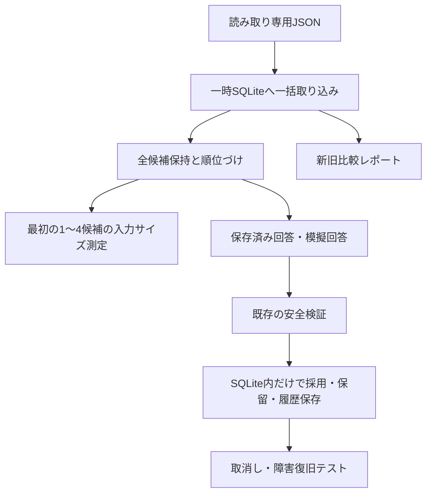

# ニュースの現在地：隔離SQLiteシャドー試作品

本番非接続。今回の結論は **試作継続には価値あり、本番移行は不可** です。

最新の段階的照合の評価は `STAGE_RESULTS.md`、実記事評価表は `EVALUATION.md` です。初期試作の結果は `RESULTS.md` に保持しています。

## 実行

標準ライブラリだけで動作します。リポジトリのルートから実行します。

```sh
python experiments/engine_v2/run_offline.py
python experiments/engine_v2/compare.py --snapshot /path/to/read-only-snapshot --snapshot-revision COMMIT_SHA --output /tmp/news-now-comparison.json
```

`compare.py` の出力先は入力スナップショット外に限定します。省略時は標準出力です。SQLiteは既定で `:memory:` の一時DBです。テストではスナップショット外の一時ファイルを再オープンして再開も検証します。次段階の再実行は以下です。

```sh
python experiments/engine_v2/stage_compare.py --snapshot /path/to/read-only-snapshot --snapshot-revision COMMIT_SHA --output-dir /tmp/news-now-stage-results
```

DBの永続化・本番エクスポート・本番切り替え・HTTPクライアントはありません。比較・テストで実通信を禁止します。現行の実行経路、Actions、既存コードは変更していません。

## 構成



## データ構造

`schema.sql` に定義しています。

|テーブル|役割|
|---|---|
|source_files|取り込み対象JSONの原文・SHA-256。未知のフィールドも保持|
|articles / revisions|URLと内容の改訂。URL・タイトル・説明・公開日時の指紋を使用|
|events / aliases|既存の事件ID・元データと保存済み別名|
|event_articles|出来事と記事改訂の対応。現行と履歴を区別|
|facts|進展・完結の根拠。引用、URL、任意の改訂参照、検証状態|
|progress|進展履歴。現在の状態はevents内の元フィールドを維持|
|schedules|予定ID、現在と変更前の版|
|holds / candidates|保留、順位、未照合状態、順位の理由|
|decisions|保存済みAIキャッシュ、不成立記録、新しい模擬判定|
|operator_decisions|運営者の判断IDと原文|
|budget|元の台帳と模擬予約の台帳を分離|
|changes|検証済み模擬変更と取消し履歴|
|sessions / candidate_checks|記事改訂・根拠の世代ごとの候補順、カーソル、未照合状態|
|batch_records / batch_cache|候補群の入力と不成立、採用前に保存した回答。保存障害後も再利用|

元のイベントは完全一致で再構成できます。取り込み済み根拠を正しいと推測せず `imported_not_revalidated` と記録します。独立した状態・事実の完全正規化は未実装です。根拠の改訂参照は未確認のものをNULLで保持します。

取り込み対象は events、tracking_pending、news_status、tracking_triage、status_pending、operator_review_decisions、data_corrections、ai_budget、ai_response_cache、tracking_review_recent の10 JSONです。存在しない入力は空として扱うため、CLIの完全な移行適格性判定は未実装です。巨大なmerge_reviewと収集・現在地分類の全運用記録は未取り込み。本番移行の阻止条件です。

## 検索・安全検証

事件名・保存済み別名・全保存記事・記事改訂履歴を日本語の文字3-gramで比較します。頻出文字列の重みを下げ、既知URLと有効な運営者指定先を優先します。明示的な案件番号は同じ文字列が存在する場合だけ加点します。施設・当事者の固有表現抽出、発生日の専用索引、永続全文索引は未実装です。

現行の編集保留事件を除き、候補は全件保持します。カテゴリ・地域・公開日で除外せず、休眠・完結事件も検索できます。順位は根拠ではありません。運営者指定先は先頭に置き、別の追加先への採用を許しません。指定先が利用不可なら他の事件へ流用せず保留します。

`judge` は **全候補を条件に含めた模擬回答の検証** です。比較で小さい入力を測る処理とは分離しています。`staged.py` は最初の1〜4件から次の候補群へ進み、再開位置と未照合を保持します。提示していない事件の採用、候補なしでの新事件登録は拒否します。通信するクライアントはありません。新事件の自動登録も未実装で、安全に保留します。

採用時は現行 `preflight`、`evidence`、`source_saved`、`apply_report`、`validate_saved_update` を再利用します。検証コードを書き換えていません。元記事改訂の別事件への流用や、人の指定だけによる採用を認めません。記事・根拠・運営者指定・改訂履歴・検証コード・回答が同じ不成立は一度だけ記録します。PR #16と同じ運用記録の除外を使用します。旧キャッシュキーは保存しますが、新入力へ無条件に転用しません。

採用・対応・派生履歴は同じSQLトランザクションで更新します。取消しは直近の変更だけを対象にし、後続変更があれば再確認を要求します。取消し後も記事改訂とAI判断を消しません。全面的な訂正伝播・複数変更の巻き戻しは未実装です。

## 予算・保留

模擬予約は現在の単価・保守的入力上限を使用し、日0.20ドル・月5ドル・日40回・実行24回・追跡8回を超えません。元の台帳をコピーした別キーに予約し、元の支出はリセットしません。実API、使用量精算、レート制限再試行は未実装です。模擬回答の検証はキャッシュ回答として扱い、予約処理と分離しています。

予算不足は記事・候補を残して `budget_deferred`、根拠不足は `needs_evidence`、同じ不成立は据え置きます。根拠不足の再開条件は署名の変化です。手動確認・編集保留は優先します。候補群の再開と同じ不成立の据え置きを実装しました。3つの異なる形式不成立は手動確認で停止し、残りの候補を保持します。定期実行への接続、記事間の公平な順番、重要予定の予約枠は未実装です。

## Actionsでの永続化案（今回は実施しない）

|案|利点|課題|
|---|---|---|
|非公開オブジェクトストレージにSQLiteの整合したスナップショット|Actionsを継続しやすい|単一書き込み、世代付き条件更新、復旧、バックアップが必要。生きたWALファイルだけをコピーしない|
|マネージドSQLへ接続|永続化、管理画面、同時利用に向く|料金、認証、トランザクションと条件更新の保証を確認|
|永続ディスクを持つ単一ワーカーのSQLite|処理とDBを近くに置ける|サーバー保守とバックアップが必要|

Actions成果物を唯一の正本にせず、公開リポジトリへ内部DBをコミットしません。永続化方式は今回決めていません。

## 結果・切り替え条件

実測は `RESULTS.md` と `results.json`。新旧で同じ保存データを用い、実データの正解ラベルを推測しません。初期試作は231テスト成功。次段階は249テスト成功、実通信0、JSONハッシュ不変です。

次は、人が根拠確認した正解標本、段階的照合の実データ・予算下での有効性確認、改訂参照付きの事実・状態モデル、全運用記録の移行、永続化・予算精算・復旧の検証が必要です。正解候補の欠落、根拠のない採用、記事消失、予算台帳のリセット、運営者判断の流用、復旧不能が一つでもあれば切り替えを止めます。本番切り替えは別途承認が必要です。

## 15組の確認と候補群の比較（隔離試作）

`REVIEW_GUIDE.md` に使い方と15組の一覧、`review.html` に通信なしの単一ファイル確認画面があります。判断JSONは確認記録専用で、評価ラベル・本番振り分けには反映しません。全15組、特にAI採用2組も正解未確認です。

`BATCH_RESULTS.md` と `batch_results.json` は固定1/2/4/8、1→2→4→8、最初4件→残り最大64件の比較です。最後の方式は残りが64件を超える場合も切り捨てず、次の64件群として保持します。段階ポリシーはセッションの不変contextに保存し、batch_size整数列は初回の件数を維持します。

通信なしの再現コマンド（出力先は入力スナップショットの外）:

```sh
python experiments/engine_v2/batch_experiments.py --snapshot /path/to/frozen-copy --output-dir /tmp/news-now-batch-results
python experiments/engine_v2/build_review.py --snapshot /path/to/frozen-copy --output /tmp/news-now-review.html
python experiments/engine_v2/hard_samples.py --snapshot /path/to/frozen-copy --output /tmp/news-now-hard-samples.json
python experiments/engine_v2/run_offline.py
```

固定評価JSONは前段のf4b831dスナップショットに基づきます。記事・事件・根拠が変わった別スナップショットで同じ比較結果になるとは主張しません。最新main確認時点と検証の制約は `VALIDATION.md` に記録しています。画面描画・スマホ実機は未確認で、ページJavaScriptのJSON入出力はDOM代替でテスト済みです。API料金や実AI精度の改善は未測定です。

## 運営者の確認記録を使った再検証

`operator_review_records.json` は添付された15組の記録をそのまま保持した検証入力です。元の `evaluation.json` や本番の運営者振り分け設定へ反映していません。本文確認済み7組、未確認部分がある同一判断6組、保留2組、従来の暫定18組を分けた結果は `OPERATOR_REVALIDATION.md` と `operator_revalidation_results.json` にあります。

```sh
python experiments/engine_v2/operator_revalidation.py --snapshot /path/to/frozen-copy --records experiments/engine_v2/operator_review_records.json --output-dir /tmp/news-now-operator-revalidation
python experiments/engine_v2/run_offline.py
```

固定f4b831dスナップショットの一時コピーで比較します。入力は読み取り専用、出力先は入力の外です。記録の事件ID・根拠ハッシュに加え、元の記事ペアから根拠ハッシュを再計算します。不正・欠落・重複のある15組の読み込みは一括拒否します。

人の判断を模擬AI回答やプロンプトへ差し込まず、従来と同じ回答で候補・入力サイズを再評価します。本文を読んだフラグやメモだけで既存の安全検証を通すことはありません。本文確認済みも運営者の申告に基づく評価参照で、本文原文と引用は未提供です。
