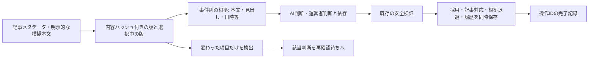

# 記事改訂・判断同期の隔離試作

記事を訂正したら全部をやり直す方式ではなく、変更された内容を使った判断だけを再確認待ちにします。旧記事・旧引用・AI回答・運営者判断は消さず、新しい版と操作履歴を足します。本番JSONや公開サイトは書き換えません。

## 実装した経路

`revision_sync.py` / `revision_sync.sql` は一時SQLite用です。前段の記事管理表と、既存の `engine.judge` / `engine.undo` / `reserve_mock` を再利用します。

この同期APIでは既存の事件への採用・取消しを試作しました。新事件の自動登録、事件同士の自動統合は追加していません。文字一致だけで採用せず、既存の誤統合・進展・根拠・正式な運営者振り分けの検証を必ず通します。

## 状態・依存・履歴

|対象|管理方法|
|---|---|
|版と内容|記事メタデータ版と本文内容IDを分け、sync_source_statesに旧状態と親状態を追記。sync_headsだけが選択中の版を指す|
|変更項目|本文、見出し、説明、公開日時、メタデータ全体、取得状態のハッシュ/値を別に保持|
|根拠|sync_evidenceに事件ID・URL・元の状態ID・対象項目・原文引用・参照時のハッシュを保存。別事件の根拠をそのまま流用しない|
|判断|sync_decisionsは元の結果を保存し、sync_decision_stateだけをcurrent/needs_recheck/cancelled/supersededへ変更。遷移も別履歴に追記|
|運営者判断|元の15記録を保存して両出典へ依存を付ける。評価参照であって、本番の振り分け設定や確定正解には反映しない|
|事件との対応|sync_linksは現在/履歴の版を保持。採用・取消しと同一トランザクションで更新。前段のsep_event_mentionsは固定スナップショットの取込履歴として残す|
|旧根拠|旧エンジンがfacts表を再構成する前後をsync_fact_archiveへ退避。元の行ID・未知のフィールド・引用を保持し、正解へ昇格しない|
|回答と予算|回答キャッシュ、予約、検証済み不成立メモ、操作の完了記録を分離。回答を再利用しても既存の採用ガードを迂回しない|

本文を使った判断は本文ハッシュと取得状態に依存します。見出しだけを使う参照判断は見出しに依存します。ただし、実際の模擬AIジョブは、送信する新記事・対象事件の記事メタデータもすべて依存として登録します。「本文だけ」と宣言して実際には見出しを送る、といった依存漏れを避けます。

本文のどの一文が変わったかという意味理解までは行いません。本文全体を使った判断は、引用部分が残っていても本文の変更で再確認対象です。同じ人物だから、同じ地域だからという理由で依存や事件をまとめません。

## 改訂と再評価

- **本文訂正**：新しい本文を別の内容IDで保存。依存するAI/運営者判断をneeds_recheckへ移し、旧回答は履歴として保持します。
- **見出し・日時だけの変更**：実際にそれを参照する判断だけを対象にします。模擬本文を同時に供給し「同じ本文を再確認できた」ケースと、本文を再確認していないケースを分けます。
- **本文未提供のメタデータ変更**：古い本文は履歴に残しますが、新しい記事版でも同じ本文だと推測しません。
- **取得失敗**：削除扱いにせず、元の選択版・判断を保持し、取得再試行待ちを記録します。
- **削除・空本文**：旧原文や引用を消さず、取得状態の変化として関連判断を再確認待ちにします。記事が消えたことを、事件が終わった/事実が誤りとみなす根拠にしません。
- **共有記事**：同じURLの根拠を使う複数事件へ影響を記録します。事件IDは統合しません。

変化した項目の世代番号も保持します。訂正を元の文章に戻しても、古い判断を自動でcurrentへ戻しません。新しい検証条件として再確認できますが、AI入力が以前と同じなら回答キャッシュは再利用でき、追加の予算予約をしません。

同じ内容をもう一度観測しただけなら世代番号を増やさず、同じ入力・回答・検証条件の不成立判定を再消費しません。無関係なURLの判断・キャッシュは変更しません。検証規則そのものの変更等は別の条件変更です。

運営者判断が再確認待ちになった場合、新AI判断で押し切らず、同じ事件の該当運営者判断を明示的に再確認/置換するまで採用を止めます。元の運営者記録は残します。評価上の判断を根拠や本番振り分けに自動転用しません。

## 採用・取消し・再採用

1. `make_job` で入力・根拠・対象事件・正式な振り分け・検証処理の版を固定します。対象事件の記事は保存済みの過去の文脈として残し、改訂後の原文へ勝手に書き換えません。
2. `call_mock` が一時SQL予算を保守的に予約し、模擬回答を永続化します。実APIクライアントは実装していません。
3. `adopt` が引用照合と既存の `valid_answer` / `engine.judge` を通した後、事件の変更・記事との対応・AI判断・根拠退避・採用記録・完了記録を一つのSQLiteトランザクションで保存します。
4. `cancel` は既存の `engine.undo` により復元します。後の変更がある状態を無理に巻き戻しません。取消し後も旧版、採用/取消しの履歴、回答を残し、事件を再確認対象にします。
5. 再採用は新しい操作IDと検証を必要とします。同じ入力の回答キャッシュを利用できても、取消しをなかったことにはしません。

操作IDはコマンドの内容と結び付けます。同じIDで異なる記事・本文・操作を実行しようとすると拒否します。コミット済みの同じ操作は完了記録を返すだけです。返却されるのは元の操作結果であり、その後の改訂でneeds_recheckになった判断を再承認する意味ではありません。画面や後段は現在の判断状態も確認する必要があります。

## 障害と予算

- 版保存、判断保存、対応更新、取消しの途中で落ちた場合、トランザクションを巻き戻します。
- コミット後に応答だけが失われた場合、同じ操作IDを再実行しても採用・履歴を増やしません。
- 回答キャッシュは採用トランザクションより先に保存するため、採用のやり直しでAI/予算を再消費しません。
- 予約後に止まっても、同じ回答要求の予約を重複計上しません。異なるワーカーが同じ予約を使う場合も、呼出し前の状態変更を条件付き更新にしています。ただし多ワーカーの実負荷検証は未実施です。
- 呼出した後に回答を保存できたか不明なら、`calling/uncertain` のまま確認待ちです。勝手に再呼出ししません。実HTTPでの厳密な一回課金を証明した試験ではありません。
- 前日/前月の未使用予約を当日の予算として使い回しません。期間が変わった予約は照合待ちにします。
- 日0.20ドル/月5ドル、日/実行ごとの回数上限は既存のreserve_mockをそのまま使います。本番予算JSONは変更しません。

## 引用照合

引用は、指定された保存版・本文内容IDのハッシュを再計算して一致を確認したうえで、文字列をそのまま照合します。保存内容の破損は不一致として止めます。全角半角・記号・言い換え・文の連結は補正しません。旧引用は旧版に対して再現でき、現在版に対してはstaleとして区別します。原文が未取得/再確認されていない場合は未検証です。

明示された引用が不一致/未検証なら採用前に止めます。文字一致しても発信者の真正性・事件同一性・進展・完結を証明したことにはならず、既存の安全検証が引き続き必要です。

元の7組14出典の本文引用・確認日時は未提供のままです。今回新たに使った本文と訂正は、明示した模擬データです。実記事の本文を取得/確認したという結果には混ぜません。

## 残る接続と移行阻止条件

- 同期APIの採用/取消しは動作しますが、段階的照合スケジューラの全経路をこのAPIへ自動接続していません。固定33組の比較は既存判断の互換試験で、動的同期の精度試験とは別です。
- 旧AIキャッシュ・旧事実の全依存は分からないため、勝手に依存を推定して新台帳の検証済み判断に移しません。元データを保持し、未移行として扱う必要があります。
- 本文だけ変更しRSSメタデータが変わらないケースは、既存source_savedガードを迂回しません。新たな本文根拠を安全に既存の採用判定へ接続する工程は未完成です。
- 再確認表示を公開サイトへ反映する出力、実原文による精度試験、長期/低順位続報の十分な標本、実API・請求照合、GitHub ActionsのDB永続化/バックアップ/復旧は未確認です。
- 保存されている版同士の時系列は、公開日時だけから推定しません。実取り込み時の観測順序・古い応答の扱いと、複数ワーカーの競合負荷試験も必要です。

これらが揃い、別途承認されるまで本番へ切り替えません。
